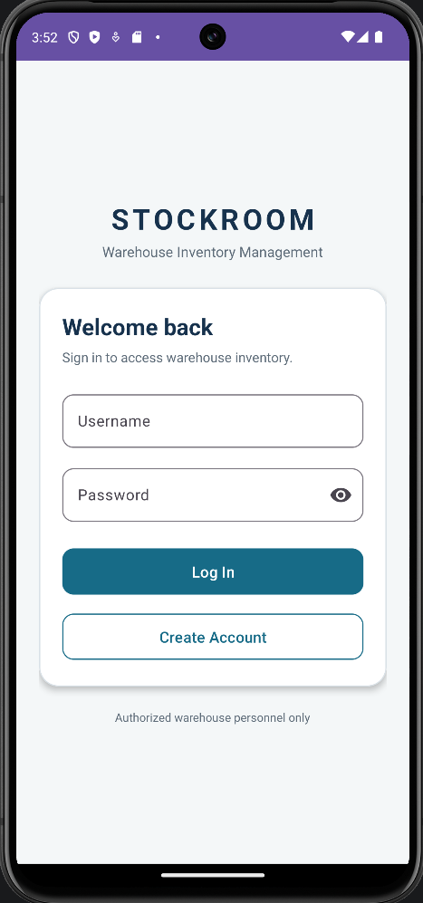
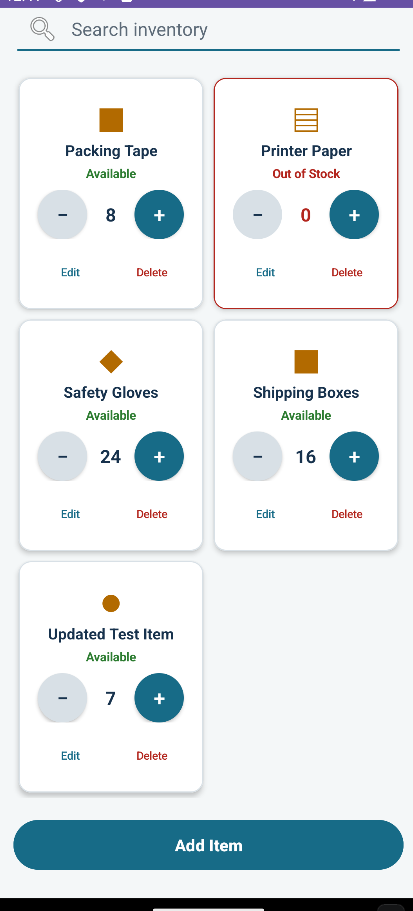
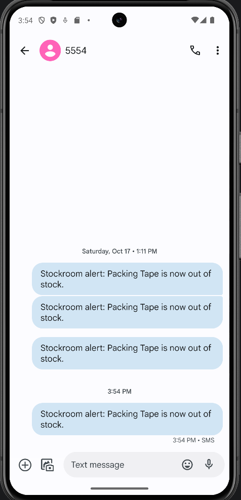

# CS-360-Android-Inventory-App

A native Android application for managing warehouse inventory through a clear, task-focused mobile interface. The app combines account authentication, persistent SQLite storage, inventory management, stock-level controls, and optional SMS alerts in a cohesive workflow.

## Application Preview

<table>
  <tr>
    <td align="center">
       
      <strong>Secure Access</strong> 
      Users can log in or create an account.
    </td>
    <td align="center">
       
      <strong>Inventory Management</strong> 
      Users can search, add, edit, delete, and adjust inventory.
    </td>
    <td align="center">
       
      <strong>Zero-Stock Alerts</strong> 
      An SMS alert is sent when an item reaches zero quantity.
    </td>
  </tr>
</table>

## Project Overview

The goal of this application was to provide warehouse personnel with a reliable way to monitor inventory from a mobile device. Users needed to securely access the app, view current inventory, add and edit products, remove outdated records, adjust quantities, and receive a notification when an item reached zero stock.

The application addresses these needs through four primary areas:

- User registration and login
- Persistent inventory storage
- Inventory search and management
- Optional zero-stock SMS alerts

A completed version of the Android Studio project is available here:

[Download the completed project](InventoryApp.zip)

## User-Centered Interface Design

The interface was designed around the tasks users would perform most frequently. The login screen provides a straightforward entry point while also allowing first-time users to create an account. After authentication, users are taken directly to the inventory screen, where the most important information and controls are immediately available.

Inventory records are displayed as consistent cards that separate each item’s name, description, quantity, and management controls. Clearly labeled increase and decrease buttons allow quantities to be updated without opening another screen. Edit and delete actions remain visually distinct so that users can quickly identify each operation. A search feature helps users locate specific products as the inventory grows.

The add and edit interfaces use labeled fields and logical grouping to reduce ambiguity during data entry. The alert settings screen explains why SMS permission is requested before displaying Android’s permission dialog. SMS access is optional, and denying it does not prevent the user from accessing the app’s core inventory features. This approach supports informed consent while keeping the primary workflow accessible.

Consistent colors, typography, spacing, and button treatments establish a clear visual hierarchy throughout the application. Status colors communicate inventory conditions, while text labels ensure that meaning does not depend on color alone.

## Development Approach

I developed the application incrementally, beginning with the data model and essential user workflows before adding visual refinement and optional features. SQLite was used to create separate tables for account credentials and inventory records. I then connected the database operations to the Java activities and XML layouts responsible for login, account creation, inventory display, and item management.

Each major feature was implemented and verified independently before being integrated into the larger application. This made it easier to isolate problems and prevented unrelated functionality from being affected by new changes. Reusable database methods and consistent item layouts also reduced duplicated code and helped maintain predictable behavior across the app.

This development strategy is transferable to future projects because it divides a complex application into smaller, testable responsibilities. I would continue using incremental implementation, clear separation between interface and data logic, descriptive naming, and comments for behavior that may not be immediately apparent to another developer.

## Testing and Validation

Testing included both individual features and complete user workflows. I used the Android Emulator to evaluate account creation, valid and invalid login attempts, inventory creation, editing, deletion, search, and quantity adjustments. I also closed and reopened the application to confirm that user accounts and inventory records remained available through SQLite persistence.

The zero-stock alert workflow was tested by granting SMS permission, reducing an item’s quantity to zero, and confirming that the message appeared in the emulator’s Messages application. I also tested the denied-permission path to verify that the application continued operating normally without SMS access.

Testing revealed issues that were not obvious from reviewing the code alone, including inconsistent card presentation, controls being visually clipped, inventory views not refreshing immediately after saving an item, and differences between emulator SMS behavior and a physical device. Addressing these findings improved both reliability and usability. The process reinforced the importance of testing application state changes, persistence, permission outcomes, and presentation rather than relying only on a successful build.

## Challenges and Problem Solving

One of the most challenging areas was coordinating the database, inventory interface, and notification behavior. A quantity update needed to modify the correct SQLite record, refresh the displayed inventory, detect when the value reached zero, and initiate an alert only when the required permission was available.

SMS testing presented an additional challenge because the emulator initially reported that SMS functionality was unavailable. I reviewed the application’s device checks and permission flow, configured a compatible emulator, and validated the result through the emulator’s Messages application. This required distinguishing between a problem in the application and a limitation of the testing environment.

I also refined the dynamic inventory cards so that newly added records matched the appearance and behavior of existing records. Resolving these issues required iterative debugging across the XML layouts, Java event handling, database operations, and emulator configuration.

## Demonstrated Skills

The strongest component of this project is the integration between persistent inventory data and the interactive user interface. Inventory changes are written to SQLite, reflected in the correct on-screen record, preserved between sessions, and evaluated for zero-stock conditions. This feature demonstrates my ability to connect data storage, input validation, event-driven Java code, dynamic interface updates, Android permissions, and device communication within a complete mobile workflow.

Through this project, I demonstrated experience with:

- Java-based Android development
- XML interface design
- SQLite database creation and CRUD operations
- User authentication and input validation
- Dynamic UI generation and updates
- Runtime permission handling
- SMS functionality
- Android Emulator testing and debugging
- User-centered mobile design
- Iterative problem solving

## Technology Stack

- Java
- Android SDK
- Android Studio
- XML layouts
- SQLite
- Material Design components
- Android Emulator
- Git and GitHub
